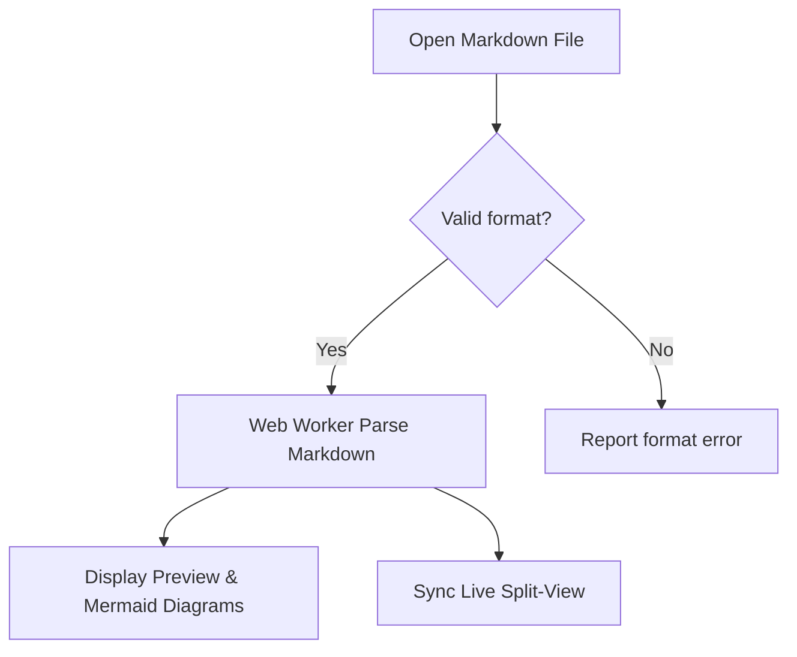

# Comprehensive Markdown Guide

Welcome to **ReadmeWeb** — clean, lightweight, open-source Markdown viewer and editor on the web, fast and secure.

---

## 1. Basic Text Formatting

You can write **bold**, *italic*, ***bold and italic***, or ~~strikethrough~~ and ==highlight==.

* Bullet list item 1
* Bullet list item 2
  * Indented sub-item
  * Another sub-item

### Task List:
- [x] Initialize ReadmeWeb project
- [x] Integrate Markdown, KaTeX & Mermaid renderer
- [ ] Open your `.md` file to get started!

---

## 2. Mathematical Formulas (LaTeX / KaTeX)

ReadmeWeb fully supports KaTeX formulas, both inline and display blocks:

* **Inline:** Energy formula $E = mc^2$, or $\sqrt{a^2 + b^2} = c$.
* **Formula Block:**

$$
f(x) = \int_{-\infty}^\infty \hat f(\xi)\,e^{2 \pi i \xi x} \,d\xi
$$

---

## 3. Code Blocks

Code blocks feature automatic syntax highlighting and a quick-copy button:

```typescript
// Sum an array of numbers
function sumArray(numbers: number[]): number {
  return numbers.reduce((acc, curr) => acc + curr, 0);
}

console.log(sumArray([1, 2, 3, 4, 5])); // Result: 15
```

---

## 4. Interactive Mermaid Diagrams

Click on any diagram below to open it in **full-screen view**, zoom from 10% to 1000%, and download PNG:




### More Mermaid examples

The installed Mermaid version also supports these diagram types.

**Gantt chart**

~~~mermaid
gantt
  title Project plan
  dateFormat YYYY-MM-DD
  section Build
  Design :done, design, 2026-01-01, 2d
  Implement :active, implement, after design, 3d
~~~

**Class diagram**

~~~mermaid
classDiagram
  User --> Order
  class User {
    +String name
  }
  class Order {
    +submit()
  }
~~~

**State diagram**

~~~mermaid
stateDiagram-v2
  [*] --> Draft
  Draft --> Published
  Published --> [*]
~~~

**Entity relationship diagram**

~~~mermaid
erDiagram
  CUSTOMER ||--o{ ORDER : places
  CUSTOMER {
    string name
  }
  ORDER {
    int id
  }
~~~

**User journey**

~~~mermaid
journey
  title Checkout
  section Buy
    Choose product: 5: Customer
    Pay: 3: Customer
~~~

**Git graph**

~~~mermaid
gitGraph
  commit id: "Initial"
  branch feature
  checkout feature
  commit id: "Feature"
  checkout main
  merge feature
~~~

**Mind map**

~~~mermaid
mindmap
  root((Project))
    Plan
    Build
    Release
~~~

**Timeline**

~~~mermaid
timeline
  title Product history
  2024 : Planning : Prototype
  2025 : Launch
~~~

**Quadrant chart**

~~~mermaid
quadrantChart
  title Priority
  x-axis Low impact --> High impact
  y-axis Low effort --> High effort
  quadrant-1 Plan
  quadrant-2 Avoid
  quadrant-3 Delegate
  quadrant-4 Do now
  Feature A: [0.8, 0.3]
~~~

**Sankey diagram**

~~~mermaid
sankey-beta
  Visitors,Trial,100
  Trial,Subscribers,35
  Trial,Churned,65
~~~

**XY chart**

~~~mermaid
xychart-beta
  x-axis [Jan, Feb, Mar]
  y-axis "Sales" 0 --> 100
  bar [30, 55, 80]
  line [25, 45, 70]
~~~

**Requirement diagram**

~~~mermaid
requirementDiagram
  requirement login {
    id: 1
    text: User signs in
    risk: medium
    verifymethod: test
  }
  element app {
    type: software
  }
  app - satisfies -> login
~~~

**Block diagram**

~~~mermaid
block-beta
  columns 2
  A["Client"] B["API"]
  A --> B
~~~

**C4 context diagram**

~~~mermaid
C4Context
  title System context
  Person(user, "User")
  System(app, "Application")
  Rel(user, app, "Uses")
~~~


---

## 5. Tables

| Feature | ReadmeWeb Support | Notes |
| :--- | :---: | :--- |
| **View Markdown** | ✅ Full | KaTeX, Mermaid, Highlight, Task list |
| **Editor** | ✅ CodeMirror 6 | Search, replace, line numbers |
| **Live Split-View** | ✅ Shortcut `Ctrl+\` | Synchronized 2-way scrolling |
| **Direct Save** | ✅ Shortcut `Ctrl+S` | File System Access API |
| **Export** | ✅ HTML / PDF / PNG | Full format support |

> [!TIP]
> Press **`Ctrl+\`** on your keyboard to toggle **Live Split-View** (side-by-side editing: type on the left, see live render on the right)!

---

## 6. GitHub Repository & Open Source

ReadmeWeb is open-source! You can explore the source code, contribute, report issues, or star the project on GitHub:

🔗 **GitHub Repository:** [https://github.com/khanglq/ReadmeWeb](https://github.com/khanglq/ReadmeWeb)

```bash
# Clone the repository
git clone https://github.com/khanglq/ReadmeWeb.git

# Navigate into project directory
cd ReadmeWeb

# Install dependencies
npm install

# Run development server
npm run dev
```
