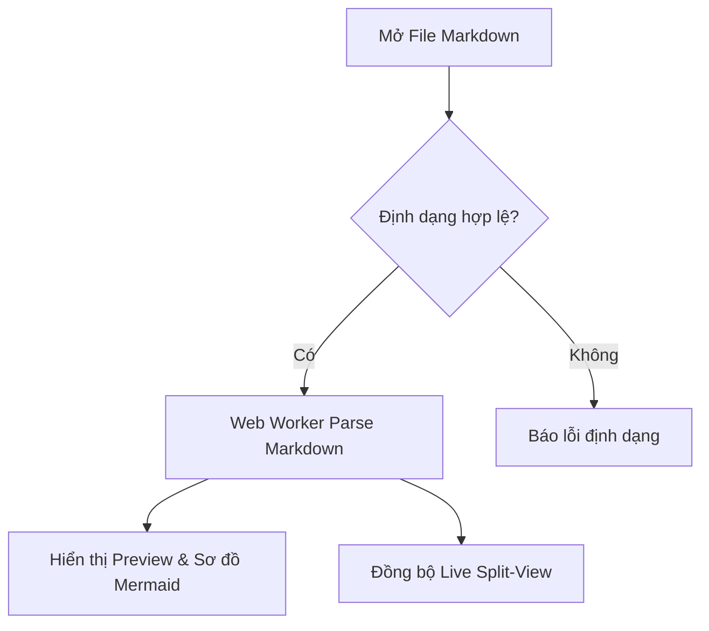

# Hướng Dẫn Markdown Toàn Diện

Chào mừng bạn đến với **ReadmeWeb** — trình xem và soạn thảo Markdown trực tiếp trên nền web, nhanh chóng, gọn nhẹ và bảo mật.

---

## 1. Định Dạng Văn Bản Cơ Bản

Bạn có thể viết chữ **in đậm**, *in nghiêng*, ***vừa đậm vừa nghiêng***, hoặc ~~gạch ngang~~ và ==đánh dấu nổi bật==.

* Danh sách gạch đầu dòng 1
* Danh sách gạch đầu dòng 2
  * Mục con thụt lề
  * Mục con khác

### Danh sách việc cần làm (Task List):
- [x] Khởi tạo dự án ReadmeWeb
- [x] Tích hợp bộ render Markdown, KaTeX & Mermaid
- [ ] Mở file `.md` của bạn để bắt đầu trải nghiệm!

---

## 2. Công Thức Toán Học (LaTeX / KaTeX)

ReadmeWeb hỗ trợ đầy đủ công thức toán KaTeX cả dạng trong dòng (inline) và khối (block):

* **Inline:** Công thức năng lượng $E = mc^2$, hoặc $\sqrt{a^2 + b^2} = c$.
* **Khối công thức toán học:**

$$
f(x) = \int_{-\infty}^\infty \hat f(\xi)\,e^{2 \pi i \xi x} \,d\xi
$$

---

## 3. Khối Mã Nguồn (Code Blocks)

Mã nguồn được tô màu cú pháp (Syntax Highlighting) tự động cùng nút copy nhanh:

```typescript
// Tính tổng mảng số nguyên
function sumArray(numbers: number[]): number {
  return numbers.reduce((acc, curr) => acc + curr, 0);
}

console.log(sumArray([1, 2, 3, 4, 5])); // Kết quả: 15
```

---

## 4. Sơ Đồ Mermaid Tương Tác

Bạn có thể nhấp chuột vào sơ đồ bên dưới để mở trình xem **toàn màn hình**, phóng to thu nhỏ từ 10% đến 1000% và tải ảnh PNG:




### Thêm các ví dụ sơ đồ Mermaid khác

Phiên bản Mermaid tích hợp hỗ trợ đa dạng các loại biểu đồ:

**Sơ đồ Gantt (Gantt chart)**

~~~mermaid
gantt
  title Project plan
  dateFormat YYYY-MM-DD
  section Build
  Design :done, design, 2026-01-01, 2d
  Implement :active, implement, after design, 3d
~~~

**Sơ đồ lớp (Class diagram)**

~~~mermaid
classDiagram
  User --> Order
  class User {
    +String name
  }
  class Order {
    +submit()
  }
~~~

**Sơ đồ trạng thái (State diagram)**

~~~mermaid
stateDiagram-v2
  [*] --> Draft
  Draft --> Published
  Published --> [*]
~~~

**Sơ đồ thực thể liên kết (Entity relationship diagram - ERD)**

~~~mermaid
erDiagram
  CUSTOMER ||--o{ ORDER : places
  CUSTOMER {
    string name
  }
  ORDER {
    int id
  }
~~~

**Hành trình người dùng (User journey)**

~~~mermaid
journey
  title Checkout
  section Buy
    Choose product: 5: Customer
    Pay: 3: Customer
~~~

**Nhánh Git (Git graph)**

~~~mermaid
gitGraph
  commit id: "Initial"
  branch feature
  checkout feature
  commit id: "Feature"
  checkout main
  merge feature
~~~

**Sơ đồ tư duy (Mind map)**

~~~mermaid
mindmap
  root((Project))
    Plan
    Build
    Release
~~~

**Dòng thời gian (Timeline)**

~~~mermaid
timeline
  title Product history
  2024 : Planning : Prototype
  2025 : Launch
~~~

**Biểu đồ góc phần tư (Quadrant chart)**

~~~mermaid
quadrantChart
  title Priority
  x-axis Low impact --> High impact
  y-axis Low effort --> High effort
  quadrant-1 Plan
  quadrant-2 Avoid
  quadrant-3 Delegate
  quadrant-4 Do now
  Feature A: [0.8, 0.3]
~~~

**Sơ đồ Sankey (Sankey diagram)**

~~~mermaid
sankey-beta
  Visitors,Trial,100
  Trial,Subscribers,35
  Trial,Churned,65
~~~

**Biểu đồ XY (XY chart)**

~~~mermaid
xychart-beta
  x-axis [Jan, Feb, Mar]
  y-axis "Sales" 0 --> 100
  bar [30, 55, 80]
  line [25, 45, 70]
~~~

**Biểu đồ yêu cầu (Requirement diagram)**

~~~mermaid
requirementDiagram
  requirement login {
    id: 1
    text: User signs in
    risk: medium
    verifymethod: test
  }
  element app {
    type: software
  }
  app - satisfies -> login
~~~

**Sơ đồ khối (Block diagram)**

~~~mermaid
block-beta
  columns 2
  A["Client"] B["API"]
  A --> B
~~~

**Sơ đồ ngữ cảnh C4 (C4 context diagram)**

~~~mermaid
C4Context
  title System context
  Person(user, "User")
  System(app, "Application")
  Rel(user, app, "Uses")
~~~


---

## 5. Bảng Biểu (Tables)

| Tính năng | Hỗ trợ trên ReadmeWeb | Ghi chú |
| :--- | :---: | :--- |
| **Xem Markdown** | ✅ Đầy đủ | KaTeX, Mermaid, Highlight, Task list |
| **Soạn thảo** | ✅ CodeMirror 6 | Tìm kiếm, thay thế, số dòng |
| **Live Split-View** | ✅ Phím tắt `Ctrl+\` | Cuộn song song 2 chiều đồng bộ |
| **Lưu trực tiếp** | ✅ Phím tắt `Ctrl+S` | File System Access API |
| **Xuất file** | ✅ HTML / PDF / PNG | Đầy đủ định dạng |

> [!TIP]
> Hãy thử nhấn **`Ctrl+\`** trên bàn phím để bật chế độ **Live Split-View** (chia đôi màn hình: vừa gõ bên trái, vừa xem kết quả render bên phải)!

---

## 6. Mã Nguồn Mở & Kho Lưu Trữ GitHub

ReadmeWeb là dự án mã nguồn mở! Bạn có thể xem mã nguồn, đóng góp tính năng, báo lỗi hoặc gắn sao (star) cho dự án trên GitHub:

🔗 **Kho mã nguồn GitHub:** [https://github.com/khanglq/ReadmeWeb](https://github.com/khanglq/ReadmeWeb)

```bash
# Clone repository
git clone https://github.com/khanglq/ReadmeWeb.git

# Di chuyển vào thư mục dự án
cd ReadmeWeb

# Cài đặt các thư viện phụ thuộc
npm install

# Khởi chạy server phát triển
npm run dev
```
