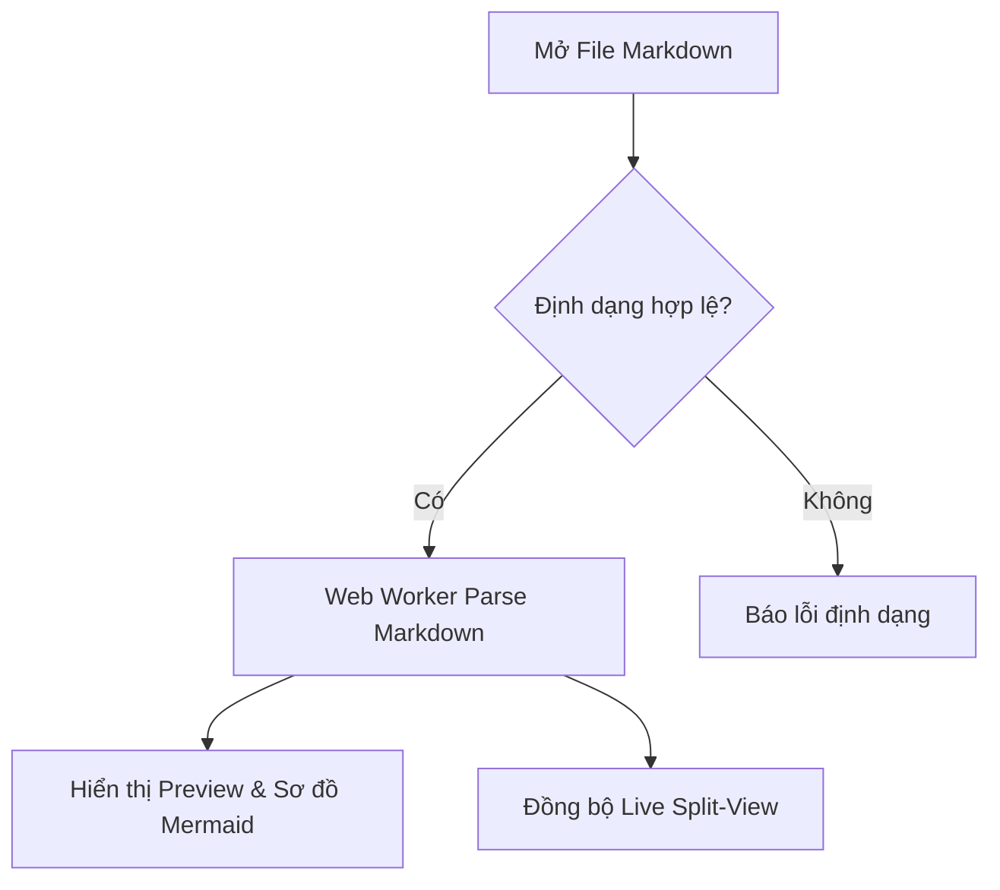

# Hướng Dẫn Markdown Toàn Diện

Chào mừng bạn đến với **ReadmeWeb** — trình xem và soạn thảo Markdown trực tiếp trên nền web, nhanh chóng, gọn nhẹ và bảo mật.

---

## 1. Định Dạng Văn Bản Cơ Bản

Bạn có thể viết chữ **in đậm**, *in nghiêng*, ***vừa đậm vừa nghiêng***, hoặc ~~gạch ngang~~ và ==đánh dấu nổi bật==.

* Danh sách gạch đầu dòng 1
* Danh sách gạch đầu dòng 2
  * Mục con thụt lề
  * Mục con khác

### Danh sách việc cần làm (Task List):
- [x] Khởi tạo dự án ReadmeWeb
- [x] Tích hợp bộ render Markdown, KaTeX & Mermaid
- [ ] Mở file `.md` của bạn để bắt đầu trải nghiệm!

---

## 2. Công Thức Toán Học (LaTeX / KaTeX)

ReadmeWeb hỗ trợ đầy đủ công thức toán KaTeX cả dạng trong dòng (inline) và khối (block):

* **Inline:** Công thức năng lượng $E = mc^2$, hoặc $\sqrt{a^2 + b^2} = c$.
* **Khối công thức toán học:**

$$
f(x) = \int_{-\infty}^\infty \hat f(\xi)\,e^{2 \pi i \xi x} \,d\xi
$$

---

## 3. Khối Mã Nguồn (Code Blocks)

Mã nguồn được tô màu cú pháp (Syntax Highlighting) tự động cùng nút copy nhanh:

```typescript
// Tính tổng mảng số nguyên
function sumArray(numbers: number[]): number {
  return numbers.reduce((acc, curr) => acc + curr, 0);
}

console.log(sumArray([1, 2, 3, 4, 5])); // Kết quả: 15
```

---

## 4. Sơ Đồ Mermaid Tương Tác

Bạn có thể nhấp chuột vào sơ đồ bên dưới để mở trình xem **toàn màn hình**, phóng to thu nhỏ từ 10% đến 1000% và tải ảnh PNG:



<!-- MERMAID_EXAMPLES -->

---

## 5. Bảng Biểu (Tables)

| Tính năng | Hỗ trợ trên ReadmeWeb | Ghi chú |
| :--- | :---: | :--- |
| **Xem Markdown** | ✅ Đầy đủ | KaTeX, Mermaid, Highlight, Task list |
| **Soạn thảo** | ✅ CodeMirror 6 | Tìm kiếm, thay thế, số dòng |
| **Live Split-View** | ✅ Phím tắt `Ctrl+\` | Cuộn song song 2 chiều đồng bộ |
| **Lưu trực tiếp** | ✅ Phím tắt `Ctrl+S` | File System Access API |
| **Xuất file** | ✅ HTML / PDF / PNG | Đầy đủ định dạng |

> [!TIP]
> Hãy thử nhấn **`Ctrl+\`** trên bàn phím để bật chế độ **Live Split-View** (chia đôi màn hình: vừa gõ bên trái, vừa xem kết quả render bên phải)!
