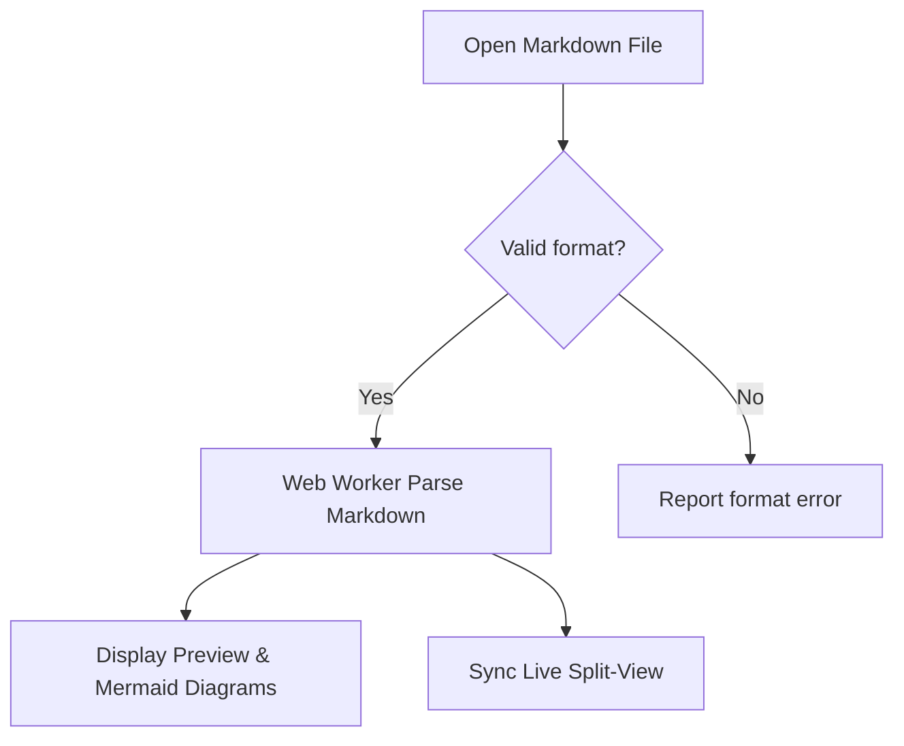

# Comprehensive Markdown Guide

Welcome to **ReadmeWeb** — clean, lightweight Markdown viewer and editor on the web, fast and secure.

---

## 1. Basic Text Formatting

You can write **bold**, *italic*, ***bold and italic***, or ~~strikethrough~~ and ==highlight==.

* Bullet list item 1
* Bullet list item 2
  * Indented sub-item
  * Another sub-item

### Task List:
- [x] Initialize ReadmeWeb project
- [x] Integrate Markdown, KaTeX & Mermaid renderer
- [ ] Open your `.md` file to get started!

---

## 2. Mathematical Formulas (LaTeX / KaTeX)

ReadmeWeb fully supports KaTeX formulas, both inline and display blocks:

* **Inline:** Energy formula $E = mc^2$, or $\sqrt{a^2 + b^2} = c$.
* **Formula Block:**

$$
f(x) = \int_{-\infty}^\infty \hat f(\xi)\,e^{2 \pi i \xi x} \,d\xi
$$

---

## 3. Code Blocks

Code blocks feature automatic syntax highlighting and a quick-copy button:

```typescript
// Sum an array of numbers
function sumArray(numbers: number[]): number {
  return numbers.reduce((acc, curr) => acc + curr, 0);
}

console.log(sumArray([1, 2, 3, 4, 5])); // Result: 15
```

---

## 4. Interactive Mermaid Diagrams

Click on any diagram below to open it in **full-screen view**, zoom from 10% to 1000%, and download PNG:



<!-- MERMAID_EXAMPLES -->

---

## 5. Tables

| Feature | ReadmeWeb Support | Notes |
| :--- | :---: | :--- |
| **View Markdown** | ✅ Full | KaTeX, Mermaid, Highlight, Task list |
| **Editor** | ✅ CodeMirror 6 | Search, replace, line numbers |
| **Live Split-View** | ✅ Shortcut `Ctrl+\` | Synchronized 2-way scrolling |
| **Direct Save** | ✅ Shortcut `Ctrl+S` | File System Access API |
| **Export** | ✅ HTML / PDF / PNG | Full format support |

> [!TIP]
> Press **`Ctrl+\`** on your keyboard to toggle **Live Split-View** (side-by-side editing: type on the left, see live render on the right)!
